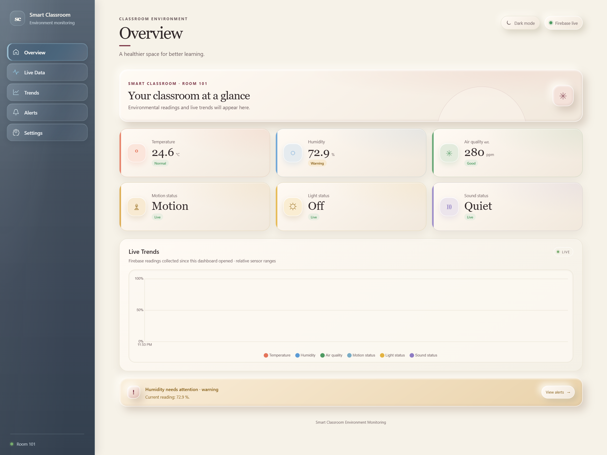
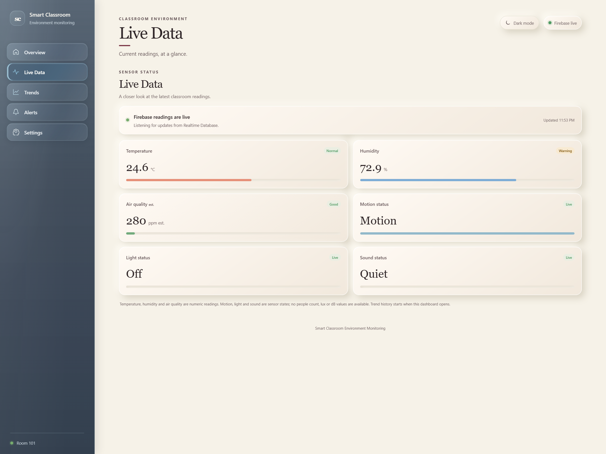
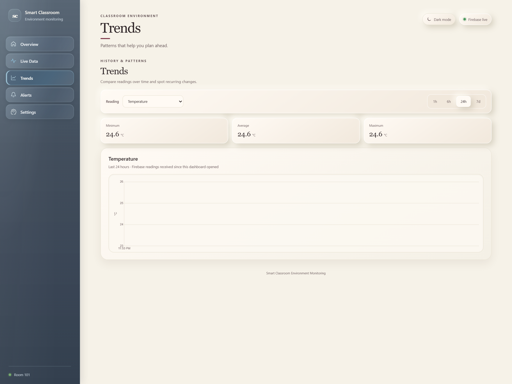

# Smart Classroom Environment Monitoring

A modern classroom monitoring dashboard that visualizes live environmental conditions and helps educators track comfort, air quality, lighting, and acoustic conditions in real time.

[](https://vite.dev/)
[](https://firebase.google.com/)

## Overview

Smart Classroom Environment Monitoring is a responsive web dashboard built for modern classrooms and smart campuses. It brings together temperature, humidity, air quality, motion, lighting, and sound data into an intuitive interface designed for quick decisions and proactive classroom comfort management.

The app can either:
- connect directly to Firebase Realtime Database for live readings, or
- run in a simulator mode for local testing and demos.

## Features

- Live classroom monitoring dashboard
- Real-time Firebase Realtime Database integration
- Light and dark theme support
- Smart alert system for comfort thresholds
- Interactive trend analysis charts
- Responsive layout for desktop and mobile usage
- Local simulator fallback when Firebase is unavailable
- Clean, warm UI tailored for academic environments

## Screenshots

<p align="center">
  
  
  
</p>

## Tech Stack

- Vite + JavaScript
- Chart.js for trend visualization
- Firebase Web SDK for live data syncing
- Custom CSS for a polished UI

## Project Structure

```bash
Smart-Classroom-Environment-Monitoring/
├── src/
│   ├── firebase.js
│   ├── main.js
│   ├── simulator.js
│   ├── thresholds.js
│   └── styles/
├── docs/
├── screenshots/
├── index.html
├── package.json
├── package-lock.json
├── .env.example
├── .gitignore
├── PRD.md
├── README.md
```

## Installation

1. Clone the repository

```bash
git clone https://github.com/KaushikChan2007/Smart-Classroom-Environment-Monitoring.git
cd Smart-Classroom-Environment-Monitoring
```

2. Install dependencies

```bash
npm install
```

3. Create your local environment file

```bash
cp .env.example .env.local
```

4. Update the Firebase values in `.env.local` with your project details.

5. Start the app

```bash
npm run dev -- --host 0.0.0.0
```

6. Open the local dev server in your browser.

## Firebase Setup

This project is designed to work with Firebase Realtime Database. The environment file should contain the following variables:

```env
VITE_FIREBASE_API_KEY=your_api_key
VITE_FIREBASE_AUTH_DOMAIN=your_project.firebaseapp.com
VITE_FIREBASE_DATABASE_URL=https://your_project-default-rtdb.firebaseio.com
VITE_FIREBASE_PROJECT_ID=your_project_id
VITE_FIREBASE_APP_ID=your_app_id
VITE_FIREBASE_DATABASE_PATH=/
```

The app listens to the configured database node and updates automatically when the readings change.

If Firebase is not configured correctly, the app gracefully falls back to the built-in simulator so the dashboard remains usable.

## Environment and Secrets Hygiene

- `.env.local` is ignored by Git
- do not commit private Firebase credentials or service-account keys
- keep `.env.example` as the safe template for others to copy
- use Firebase security rules to restrict database access

## Security Check

I validated the dependency tree and confirmed:

- `npm audit` reports zero vulnerabilities
- the app uses Firebase client config only, not secret server credentials
- secrets are not embedded in source files or committed to the repo

## Deployment

This app can be deployed on any static host or frontend hosting provider, including:
- Vercel
- Netlify
- Firebase Hosting
- GitHub Pages (with minor config changes)

For Firebase Hosting, make sure your `.env.local` values are set in the deployment environment (or build-time configuration if using a static build pipeline).

## Contributing

Contributions are welcome. If you want to improve the dashboard, please open an issue or submit a pull request with a clear explanation of the change.

## License

No license has been selected for this repository. Unless a license is added, standard copyright applies and reuse or redistribution is not automatically permitted.

## Notes

- The dashboard behavior is designed to reflect classroom conditions in a readable and user-friendly way.
- Sensor values are normalized for display and alerting.
- The app is meant to be extended with real room hardware or an IoT backend in the future.
